# 1. Introducción

Este manual explica cómo usar el **Sistema de Reservación de Hotel Paradise** para el trabajo diario de la recepción y la administración del hotel: iniciar sesión, registrar clientes y habitaciones, hacer reservaciones y consultar reportes.

## 1.1 Requisitos

- Una computadora, tableta o celular con un navegador actualizado (Chrome, Edge, Firefox o Safari).
- La dirección del sistema. En la versión de demostración es <http://127.0.0.1:8000>.
- Un usuario y contraseña que te entrega el administrador.

## 1.2 Tipos de usuario

| Rol | Qué puede hacer |
|---|---|
| **Administrador** | Todo: habitaciones, clientes, reservaciones, reportes, usuarios y el panel de administración de Django. |
| **Recepcionista** | Consultar habitaciones; registrar y editar clientes; registrar, modificar y cancelar reservaciones. |

El menú sólo muestra las secciones que tu rol puede usar. Si entras a una sección sin permiso verás el aviso *"Tu rol no tiene acceso a esta sección"*.

Usuarios de la versión de demostración:

| Usuario | Contraseña | Rol |
|---|---|---|
| `admin` | `Paradise2026!` | Administrador |
| `recepcion` | `Recepcion2026!` | Recepcionista |

## 1.3 Partes de la pantalla

- **Menú lateral** (izquierda): acceso a Dashboard, Disponibilidad, Reservaciones, Clientes, Habitaciones y, para administradores, Reportes, Usuarios y Django Admin. En el celular se abre con el botón **Menú**.
- **Barra superior**: tu nombre, tu rol y el botón **Cerrar sesión**.
- **Mensajes**: después de guardar, editar o cancelar aparece un aviso verde (éxito) o rojo (error) en la parte superior. Se cierra con la **X**.
- **Campos obligatorios**: llevan un asterisco rojo **\***. Si un dato es incorrecto, el campo se marca en rojo y debajo aparece qué corregir.

# 2. Inicio de sesión

1. Abre la dirección del sistema en el navegador. Aparece la pantalla **Iniciar sesión**.
2. Escribe tu **usuario** y tu **contraseña**.
3. Haz clic en **Entrar**.

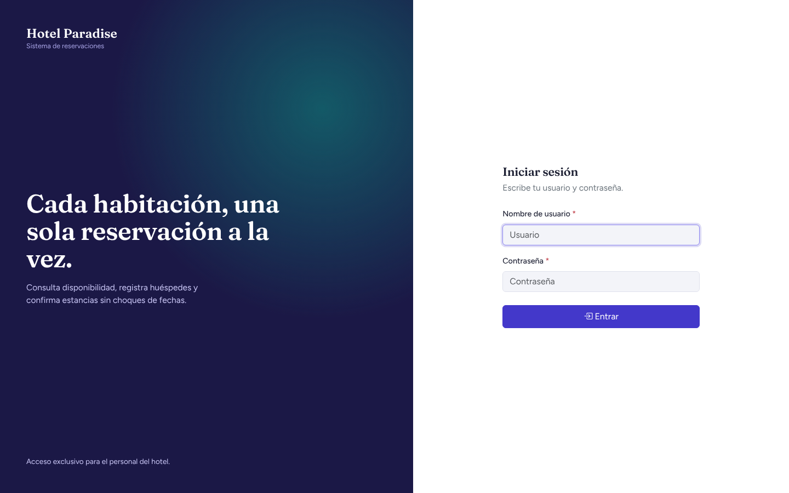

Si los datos no son correctos aparece *"Usuario o contraseña incorrectos. Verifica tus datos."*. Revisa que no esté activado Bloq Mayús y vuelve a intentarlo.

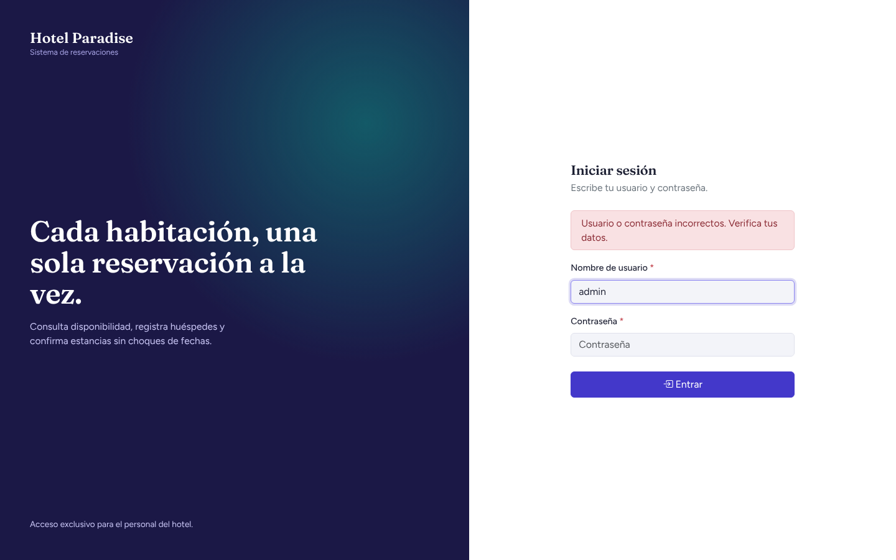

## 2.1 Cerrar sesión

Haz clic en **Cerrar sesión** (arriba a la derecha; en el celular es el ícono de la puerta con flecha). El sistema te regresa a la pantalla de inicio de sesión con el aviso *"Cerraste sesión correctamente"*. Cierra siempre tu sesión al terminar tu turno, sobre todo en computadoras compartidas.

# 3. Dashboard (pantalla principal)

Al iniciar sesión llegas al **Dashboard**, que resume el estado del hotel en el día:

- **Indicadores**: total de clientes, total de habitaciones, total de reservaciones, habitaciones disponibles hoy e ingresos generados.
- **Tablero de habitaciones**: cada cuadro es una habitación. **Verde** = libre hoy, **índigo** = ocupada, **rayado gris** = fuera de servicio. Haz clic en un cuadro para ver la habitación.
- **Llegadas de hoy**, **Salidas de hoy** y **Próximos 7 días**: los huéspedes que entran o salen.
- **Últimas reservaciones** e **Ingresos de los últimos 6 meses**.

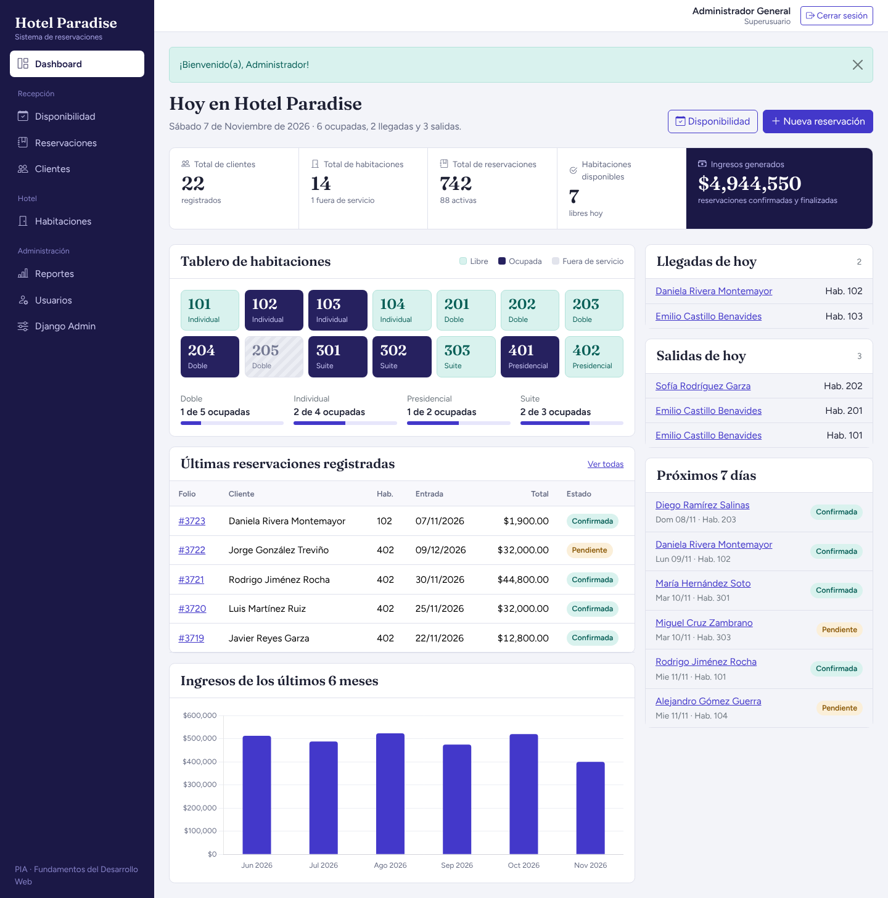

Los botones **Disponibilidad** y **Nueva reservación** (arriba a la derecha) llevan directo a las tareas más frecuentes.

# 4. Registro de habitaciones

> Sólo los administradores pueden crear, editar o eliminar habitaciones. Los recepcionistas pueden consultarlas.

## 4.1 Registrar una habitación

1. En el menú, entra a **Habitaciones** y haz clic en **Nueva habitación**.
2. Llena los datos:
   - **Número**: el número de la habitación (no se puede repetir).
   - **Tipo**: Individual, Doble, Suite o Presidencial.
   - **Capacidad**: personas que caben (de 1 a 10).
   - **Precio por noche**: en pesos, con dos decimales.
   - **Fotografía**: opcional, JPG o PNG de máximo 2 MB.
   - **Descripción**: opcional (camas, vista, servicios).
   - **Disponible**: déjalo marcado si la habitación se puede rentar.
3. Haz clic en **Guardar habitación**. Aparece *"La habitación … se registró correctamente"*.

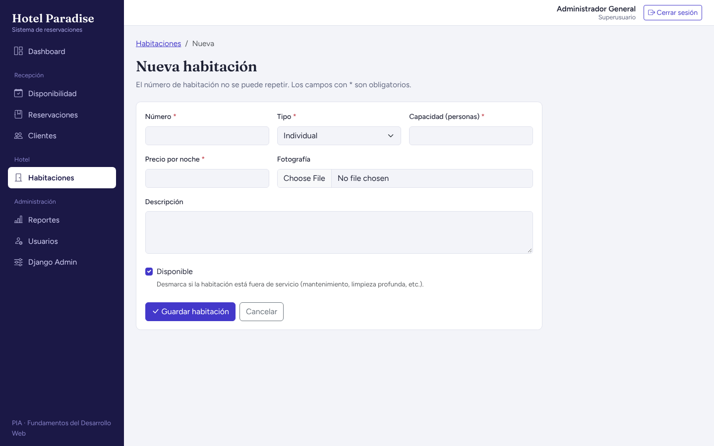

Si el número ya existe, el sistema lo indica y no guarda la habitación:

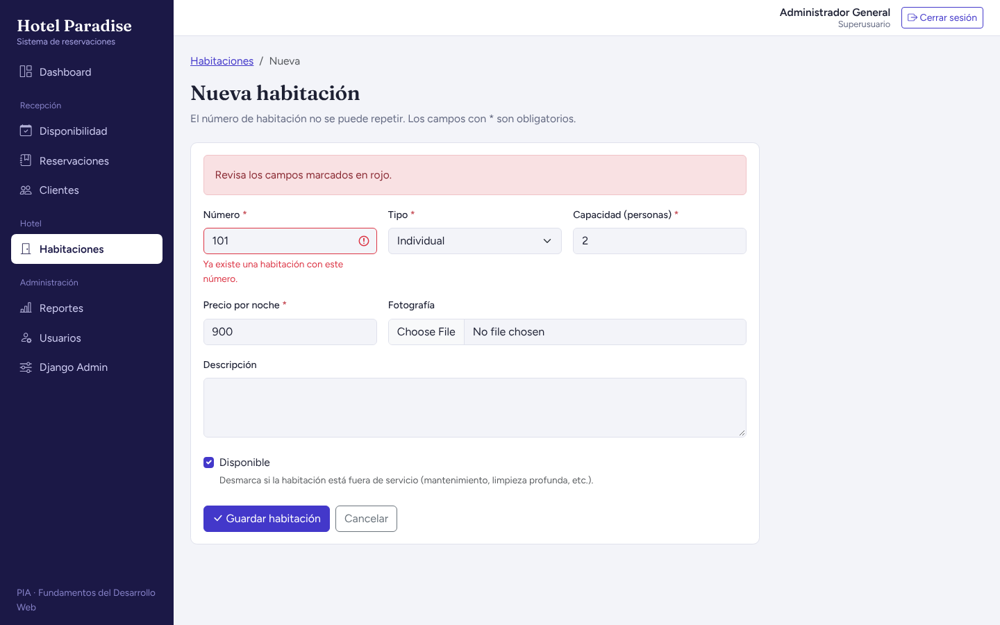

## 4.2 Buscar habitaciones

En **Habitaciones** escribe un número o una palabra de la descripción en **Buscar**, o elige un **Tipo** y un **Estado** (Disponibles / Fuera de servicio). Haz clic en **Buscar**. La **X** limpia los filtros.

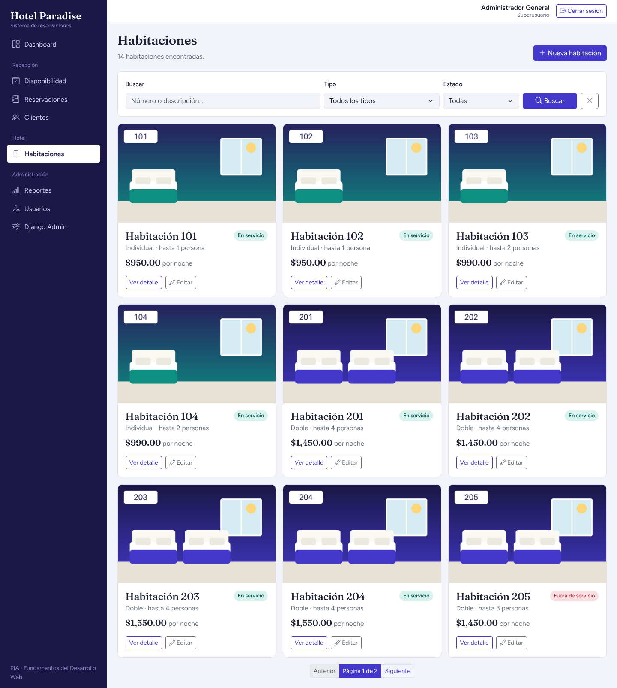

## 4.3 Consultar, editar y eliminar

- **Ver detalle**: muestra los datos, la foto y las reservaciones activas de la habitación. Desde aquí puedes **Reservar**.
- **Editar**: cambia cualquier dato y guarda. Para sacar una habitación de servicio (mantenimiento), desmarca **Disponible**: deja de aparecer para nuevas reservaciones pero conserva su historial.
- **Eliminar**: pide confirmación. **No se puede eliminar una habitación que tiene reservaciones activas**; primero hay que cancelarlas o esperar a que terminen.

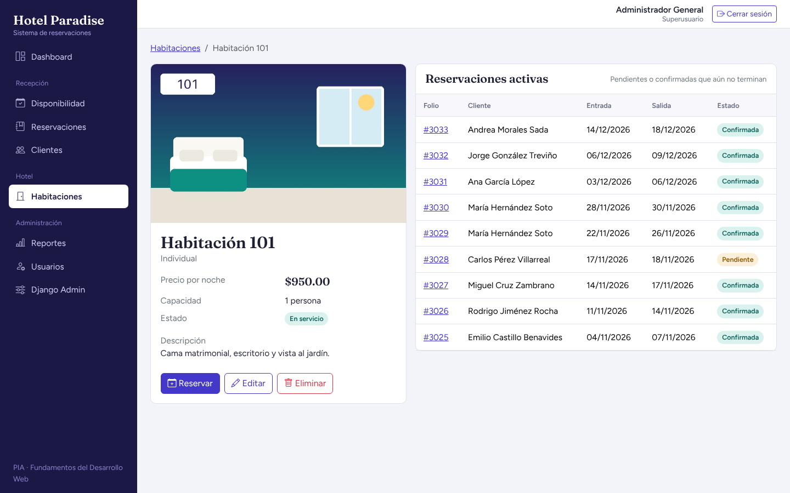

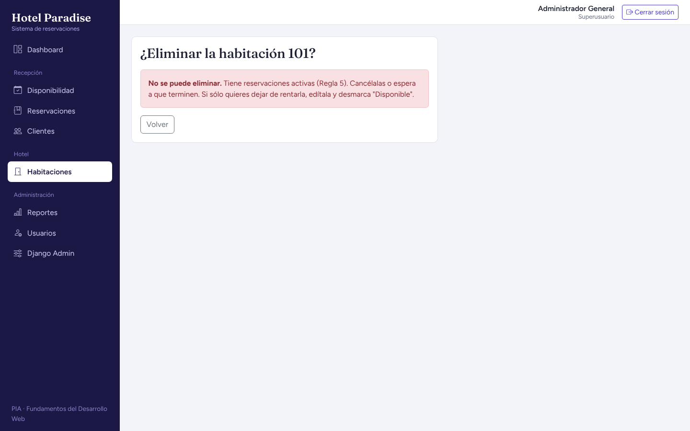

# 5. Registro de clientes

## 5.1 Registrar un cliente

1. En el menú, entra a **Clientes** y haz clic en **Nuevo cliente**.
2. Escribe **Nombre**, **Apellidos**, **Correo electrónico** y **Teléfono** (10 dígitos, sin espacios ni guiones). La fecha de registro se guarda sola.
3. Haz clic en **Guardar cliente**.

Reglas que revisa el sistema:

- El **correo** no puede estar registrado en otro cliente, aunque se escriba con mayúsculas.
- El **teléfono** debe tener exactamente 10 dígitos.
- Nombre y apellidos no deben llevar números.

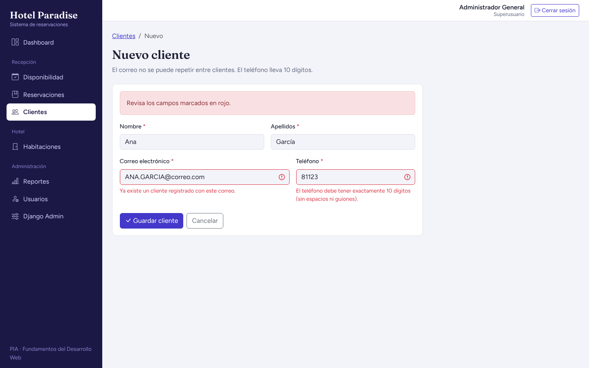

## 5.2 Buscar, editar y eliminar clientes

En **Clientes** escribe en **Buscar** el nombre, apellido, correo o teléfono (puedes escribir varias palabras, por ejemplo *"Ana García"*). En cada fila tienes los botones para **nueva reservación** (calendario), **editar** (lápiz) y **eliminar** (bote). Al hacer clic en el nombre ves el detalle con su **historial de reservaciones**.

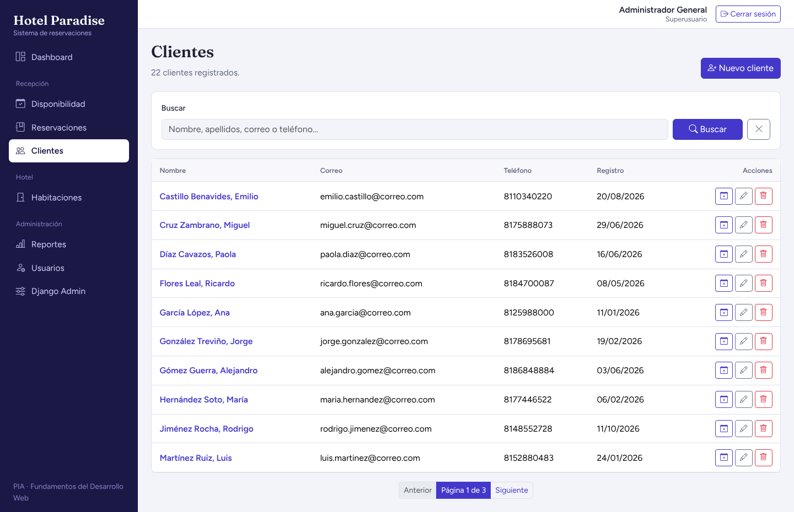

No se puede eliminar un cliente que tenga reservaciones activas.

# 6. Registro de reservaciones

## 6.1 Consultar disponibilidad

Es la forma más rápida de reservar sin errores:

1. En el menú, entra a **Disponibilidad**.
2. Elige **Fecha de entrada**, **Fecha de salida**, el **Tipo de habitación** (opcional) y el número de **Huéspedes**.
3. Haz clic en **Consultar**. Aparecen sólo las habitaciones **libres** en esas fechas, con el total de la estancia.
4. Haz clic en **Reservar esta habitación** en la que elija el huésped.

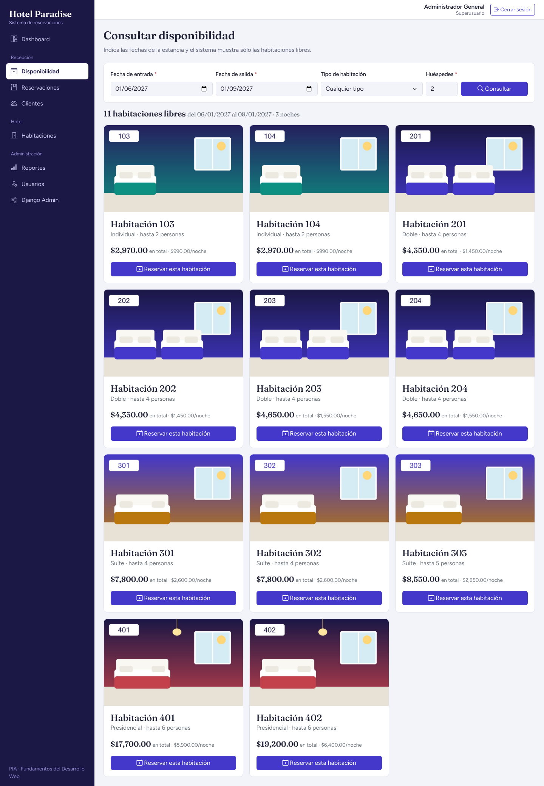

## 6.2 Registrar la reservación

El formulario llega con la habitación y las fechas ya llenas.

1. Elige el **Cliente**. Si no existe, usa el enlace *"¿No está registrado? Agrega al cliente"*.
2. Revisa las fechas, el **número de huéspedes** y el **Estado** (*Confirmada* o *Pendiente* si falta que el cliente confirme).
3. Agrega **Notas** si hace falta (llegada tarde, cuna, etc.).
4. El cuadro **Resumen** muestra el total estimado (noches × precio por noche).
5. Haz clic en **Confirmar reservación**. Aparece el folio y el total final.

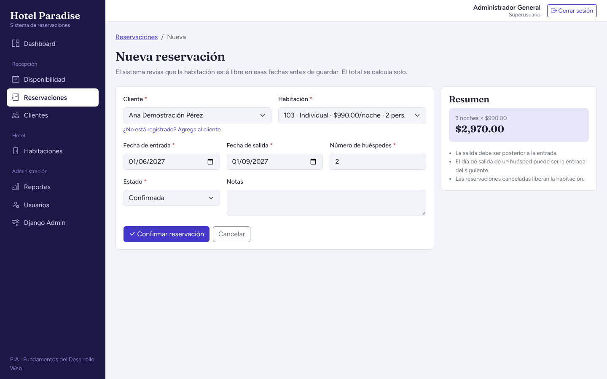

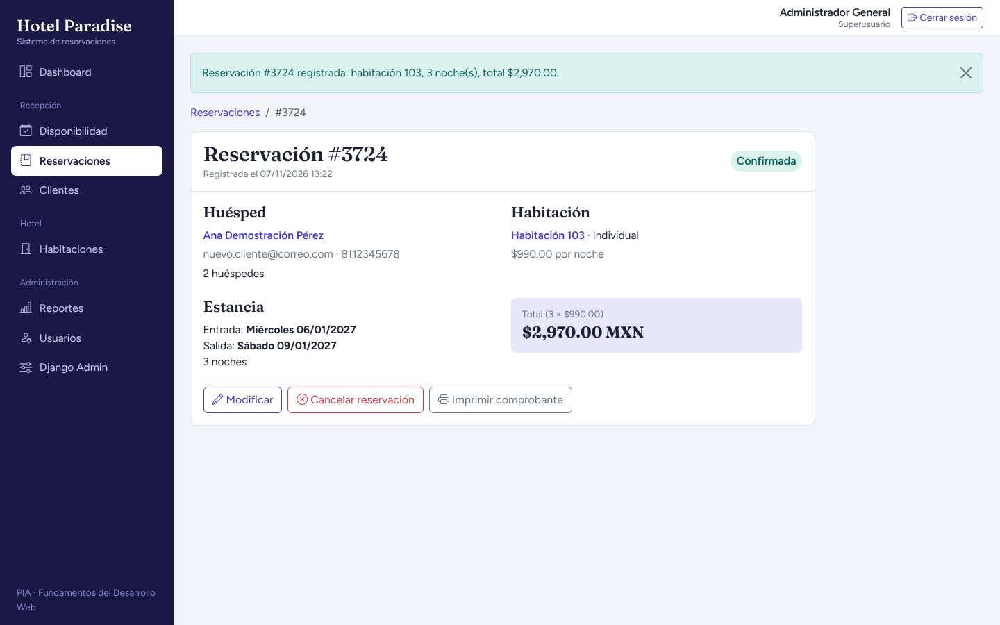

## 6.3 Mensajes al reservar

| Mensaje | Qué significa | Qué hacer |
|---|---|---|
| *La habitación X ya está reservada del … al …* | Otra reservación activa ocupa esas fechas | Usa **Disponibilidad** para elegir otra habitación u otras fechas |
| *La fecha de salida debe ser mayor que la fecha de entrada* | La salida es igual o anterior a la entrada | Corrige la fecha de salida |
| *La fecha de entrada no puede ser anterior a hoy* | Se eligió una fecha pasada | Elige hoy o una fecha futura |
| *La habitación X admite máximo N huésped(es)* | Hay más huéspedes que la capacidad | Elige una habitación más grande |
| *La habitación X está fuera de servicio* | Está en mantenimiento | Elige otra habitación |

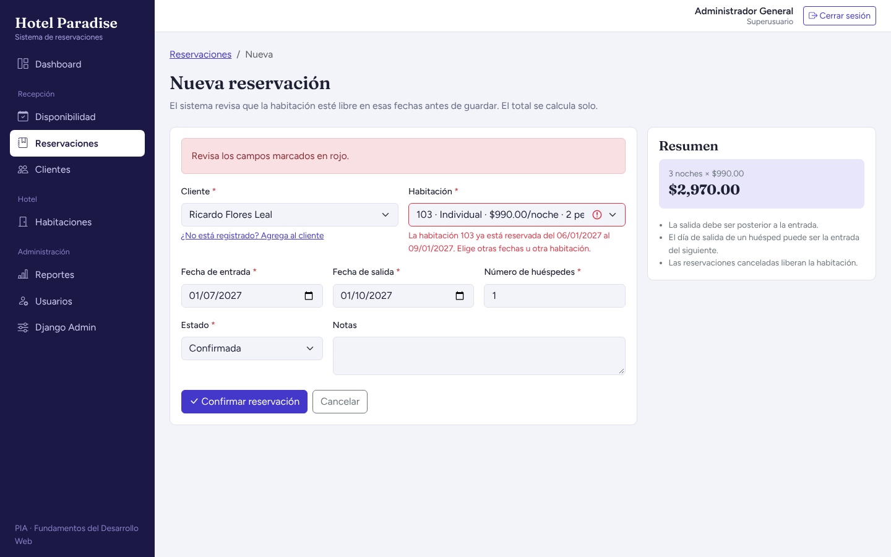

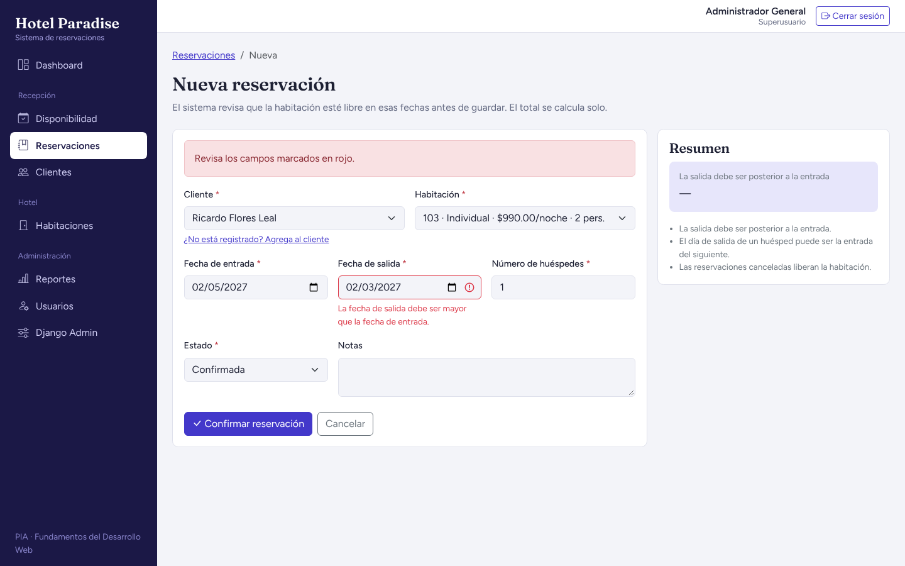

> El día en que un huésped sale, otro puede entrar a la misma habitación: eso no cuenta como choque.

## 6.4 Buscar, modificar y cancelar

- En **Reservaciones** puedes buscar por **cliente** (nombre o correo), **número de habitación**, **tipo de habitación** y **estado**.
- **Modificar** (lápiz): cambia fechas, habitación, huéspedes o estado. El sistema vuelve a revisar la disponibilidad y recalcula el total.
- **Cancelar** (círculo con X): pide confirmación. La reservación queda en el historial como *Cancelada* y la habitación se libera para esas fechas.
- Desde el detalle puedes **Imprimir comprobante**.

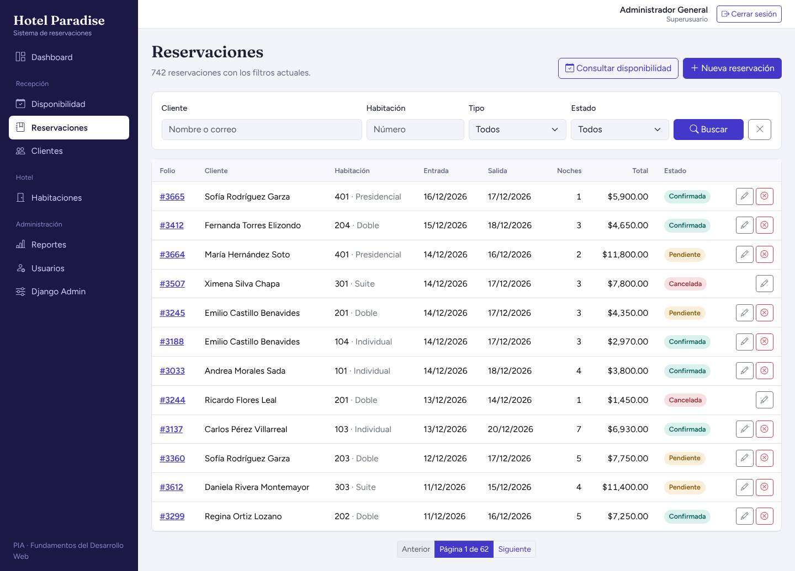

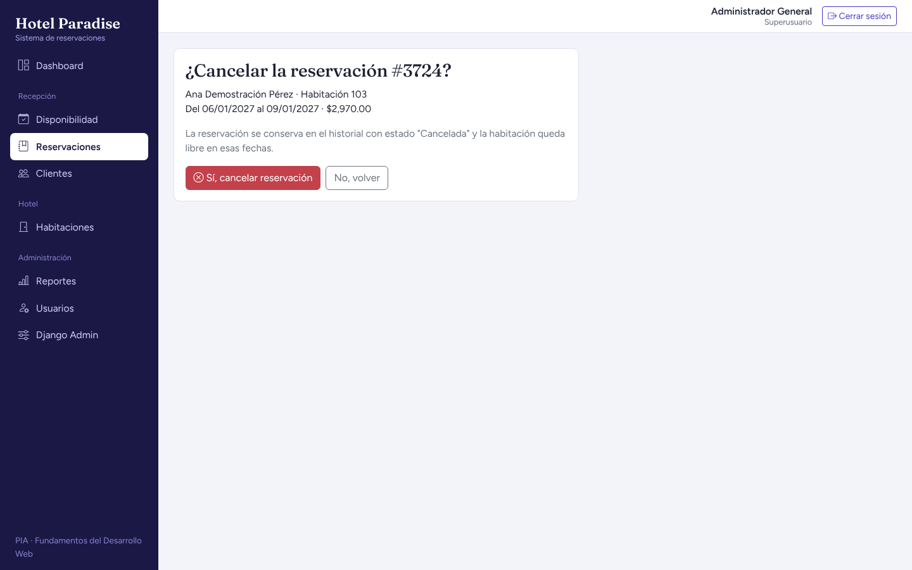

Estados de una reservación:

| Estado | Significado |
|---|---|
| Pendiente | Apartada, falta que el cliente confirme. Ocupa la habitación. |
| Confirmada | Confirmada por el cliente. Ocupa la habitación y cuenta como ingreso. |
| Finalizada | El huésped ya salió. Cuenta como ingreso. |
| Cancelada | No ocupa la habitación ni cuenta como ingreso. Se conserva como historial. |

# 7. Reportes

> Disponible sólo para administradores.

1. En el menú, entra a **Reportes**.
2. Elige el periodo con **Desde** y **Hasta** y haz clic en **Aplicar periodo** (por defecto, el año en curso). El periodo se toma por la fecha de entrada de cada reservación.
3. El reporte muestra:
   - número de reservaciones y canceladas, ticket promedio, porcentaje de ocupación e ingresos;
   - gráfica de **ingresos por mes**;
   - **reservaciones por estado**;
   - **ingresos por tipo de habitación**;
   - **clientes con mayor consumo**;
   - **ocupación por habitación** (noches ocupadas en el periodo).
4. **Exportar a Excel (CSV)** descarga todas las reservaciones del periodo; el archivo se abre directo en Excel.
5. **Imprimir** genera una versión sin menús, lista para imprimir o guardar como PDF.

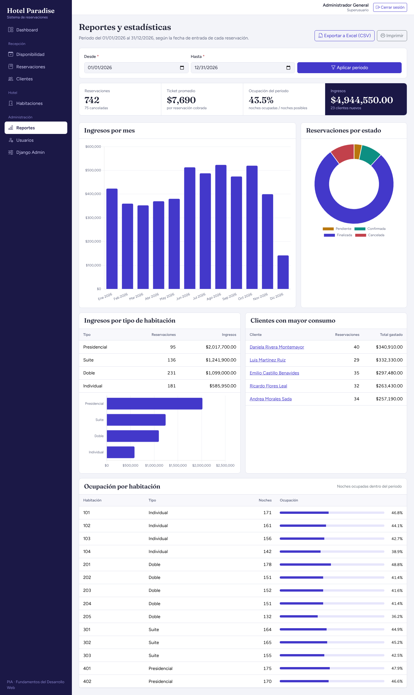

# 8. Administración de usuarios

> Disponible sólo para administradores.

1. En el menú, entra a **Usuarios**. Verás a todo el personal con su rol, estado y último acceso.
2. **Nuevo usuario**: escribe usuario, nombre, apellidos, correo (opcional), contraseña dos veces y elige el **Rol**. La contraseña debe tener al menos 8 caracteres, no ser sólo números ni parecerse al usuario.
3. **Editar**: cambia datos y rol, o desmarca **Cuenta activa** para que esa persona ya no pueda entrar (por ejemplo, si deja de trabajar en el hotel).

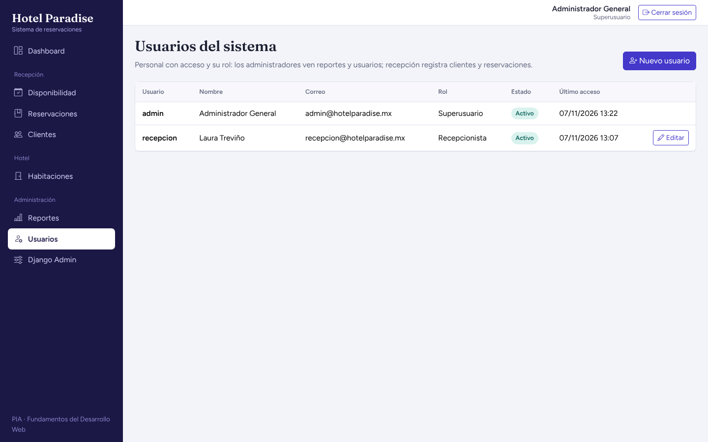

## 8.1 Panel de administración de Django

Los administradores tienen además **Django Admin** en el menú, un panel técnico para revisar y editar directamente habitaciones, clientes, reservaciones, usuarios y grupos. Tiene filtros, búsqueda y acciones en lote (por ejemplo, marcar varias habitaciones como fuera de servicio o cancelar varias reservaciones).

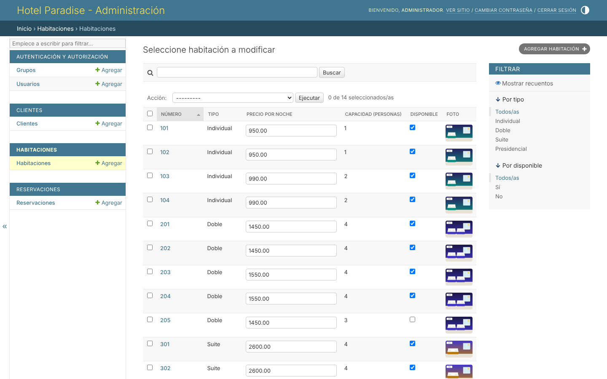

# 9. Preguntas frecuentes

| Pregunta | Respuesta |
|---|---|
| Olvidé mi contraseña | Pide al administrador que te asigne una nueva desde Django Admin → Usuarios. |
| No veo la sección Reportes o Usuarios | Tu rol es Recepcionista; esas secciones son sólo para administradores. |
| ¿Puedo usar el sistema en el celular? | Sí. El menú se abre con el botón **Menú** en la parte superior. |
| ¿Por qué una habitación no aparece al reservar? | Está fuera de servicio, ocupada en esas fechas o no tiene capacidad para los huéspedes indicados. |
| ¿Cómo cambio el precio de una habitación? | Habitaciones → Editar. Las reservaciones nuevas o modificadas usan el precio nuevo. |
| Cancelé una reservación por error | Ábrela, elige **Modificar** y cambia el estado a *Confirmada*. El sistema revisa que las fechas sigan libres. |
| ¿El total se puede escribir a mano? | No. Siempre se calcula como noches × precio por noche, para evitar errores. |
